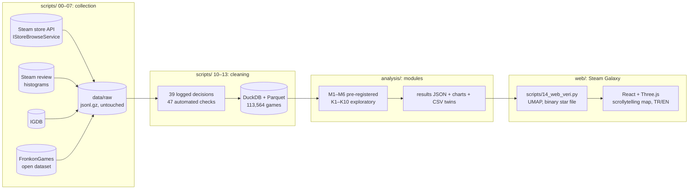

# Discovery Dynamics: Steam Galaxy

**English** | [Türkçe](README.tr.md)

**Live site:** https://mertkkenarr-dev.github.io/discovery-dynamics/?lang=en

A data analysis study of what makes an independent game visible on Steam. Every year around 20,000 games are released on Steam and
most are barely seen. This project follows 92,492 games released between 2018 and 2025, separates out major-publisher backing, and asks
which pre-launch choices go together with organic success. The results are presented as an interactive 3D map in Turkish and English:
each star is a game, nearby stars are similar games, and brightness is first-year reviews.

The work follows the Google Data Analytics framework (Ask → Prepare → Process → Analyze → Share → Act). Hypotheses were written down
and dated before the data was examined; analyses that were not pre-registered are labelled exploratory.

## Findings

- **Most games are never seen.** 54% of indie games get fewer than 10 reviews in their first year; 4.8% pass 500 reviews (a "hit").
  Yearly releases grew 2.8× (7,398 in 2018 to 20,363 in 2025), yet the hit rate stayed between 4.0% and 5.4% every year.
- **Early Access lengthens the tail** (pre-registered, supported): interest spreads over time (odds ×1.27), and games whose interest
  carries into a second year have twice the hit rate of games that spike and fade.
- **Simplified Chinese support** (pre-registered, supported): +57–75% reviews, but the most successful games added Chinese 13× more often
  after launch, so part of the link runs from success to language.
- **Familiar wins** (pre-registered "inverted U" not supported): the more unusual a game's tag combination, the less attention it gets.
  A studio's second game is not better than its first, and crowded subgenres are not a disadvantage.
- **Copying a hit adds nothing.** Close followers of big hits become hits 15.5% of the time, but games released into the same region
  before the hit did so 16.7% of the time: the hit marks a fertile region. Late followers do worse.
- **Hidden gems.** 44% of highly rated games stay invisible; visible ones are more often Simulation, priced higher, launched in Early
  Access and ran a Playtest. A pre-launch demo does not separate the two groups.
- **No "50-review algorithm threshold."** A regression discontinuity across 1 million monthly review slices finds no jump at 50 reviews
  (−1.0%, 95% CI −2.4% … +0.4%).
- **Store text carries signal.** Adding the store description to a pre-launch LightGBM model raises PR-AUC from 0.27 to 0.31 (upper bound;
  award and sales sentences removed). Longer, concrete descriptions go with success; words like "unique" or "epic" do not.
- **Genres.** Management, Dating Sim and City Builder are both low-risk and high-reward (hit rate 11–12%). Genre hybrids perform exactly
  as their parts predict: none of 176 genre pairs differs from expectations.

## Methods

- **Pre-registration:** 5 directional hypotheses tested with Holm correction; effect sizes reported with 95% intervals.
- **Causal and quasi-causal tools:** propensity-score matching with exact strata, regression discontinuity with placebo thresholds,
  first-difference designs, reverse-causality checks from repeated language snapshots.
- **Machine learning:** LightGBM with a temporal split (train ≤ 2023, test 2024–2025), SHAP contributions, TF-IDF and sentence-embedding
  text models with leak-free stacking, UMAP for the map, spherical k-means for content regions.
- **Data quality as a finding:** player tags before 2021 are selectively applied (successful games carry twice as many). Tag-based
  results were re-estimated on 2021+ games; one result that did not hold is reported as not robust.

## Architecture



**Why this stack:** The data fits on one machine (a few GB of raw API responses), so DuckDB and Parquet instead of a database server.
Raw responses are stored unchanged and every transformation is a script, so the whole pipeline can be rebuilt from `data/raw`. The site
is static: 92,492 star positions and flags are a 1.9 MB binary file read straight into GPU buffers (JSON would be ~4× larger and block
the main thread), so it runs on GitHub Pages with no backend.

## Setup

Run the site (its data files are committed in `web/public/veri/`):

```bash
cd web && npm ci && npm run dev
```

Rebuild everything from the raw sources (takes hours; collectors resume where they stopped; IGDB needs Twitch API credentials in `.env`):

```bash
cp .env.example .env && cd scripts && for s in 00_indir 01_evren 02_getitems 03_histogram 05_igdb; do uv run --no-project --python 3.12 --with pandas --with pyarrow --with pyyaml --with requests --with python-dotenv python $s.py; done && bash hat.sh && uv run --no-project --python 3.12 --with pandas --with pyarrow --with pyyaml --with requests --with numpy --with umap-learn python 14_web_veri.py
```

Raw data is not in the repository; every downloaded file is logged to `data/raw/_manifest.csv`, and `hat.sh` runs cleaning, features,
the 47 checks (it stops if any fails) and publishing. Analysis modules in `analysis/` are standalone scripts that write their results to
`analysis/sonuclar/`.

## Repository

```
docs/       scope, pre-registered hypotheses, data architecture, data and analysis reports (Turkish)
scripts/    collection (00–07), cleaning and features (10–13), web data (14); scripts/hat.sh rebuilds everything
analysis/   analysis modules, results JSON (sonuclar/), charts with CSV twins (sekiller/)
web/        Steam Galaxy site (React, Three.js, Observable Plot)
```

Full analysis report with charts: [docs/ANALIZ_RAPORU.md](docs/ANALIZ_RAPORU.md) (Turkish).

## Limitations

Steam does not publish sales, so success is measured by first-year reviews, which track sales rank but vary by genre. Outside the
pre-registered tests, findings are associations, not causes. Player tags are voted on after launch and are used with that caveat; store
pages are today's versions, so text-based gains are reported as upper bounds.

Data: Steam store and review data via public Steam endpoints; game metadata from IGDB (Twitch); the FronkonGames Steam Games Dataset (MIT).
Raw data is not redistributed. This is an independent portfolio project and is not affiliated with Valve.

**Author:** Mert Safa Kenar · [GitHub](https://github.com/mertkkenarr-dev) · [LinkedIn](https://www.linkedin.com/in/mert-kenar-02b40529b)
