# Discovery Dynamics: Analiz Raporu

*Steam'de bağımsız oyunlar nasıl görünür oluyor? Her modül kısa bir bölüm: soru, ne bulduk, ne anlama geliyor, nelere dikkat etmeli.*

**Okumadan önce bilinmesi gerekenler:**
- **Başarı ölçüsü:** Oyunun ilk 365 günde aldığı Steam incelemesi. Steam satış rakamı yayınlamıyor; inceleme sayısı satış sıralamasını iyi izliyor (sıra korelasyonu 0,59). "Hit" = ilk yılda 500+ inceleme. Her bulgu ayrıca beğeni, tahmini gelir ve göreli sıra ölçüleriyle kontrol ediliyor (bkz. M1 §6).
- **Örneklem:** 2018–2025 arasında çıkan, büyük yayıncı desteği olmayan ("organik") 66.999 oyun. Seri üretim, yetişkin içerik, yazılım ve listelenmemiş oyunlar çıkarıldı.
- **İlişki ≠ neden-sonuç.** Aksi yazılmadıkça bulgular "birlikte görülüyor" demektir. Neden-sonuç iddiası yalnız M5'te (demo ve Next Fest) kurulacak.
- Grafiklerin verileri aynı adla `analysis/sekiller/*.csv` olarak duruyor. Yöntem ayrıntıları: `docs/PILOT_RAPORU.md`, `docs/VERI_RAPORU.md`.

---

## M1: Görünürlük: oyunların ne kadarı fark ediliyor?

*Betik: `analysis/m1_gorunurluk.py` · 2026-10-24*

### 1. Her iki bağımsız oyundan biri ilk yılında 10 inceleme bile alamıyor

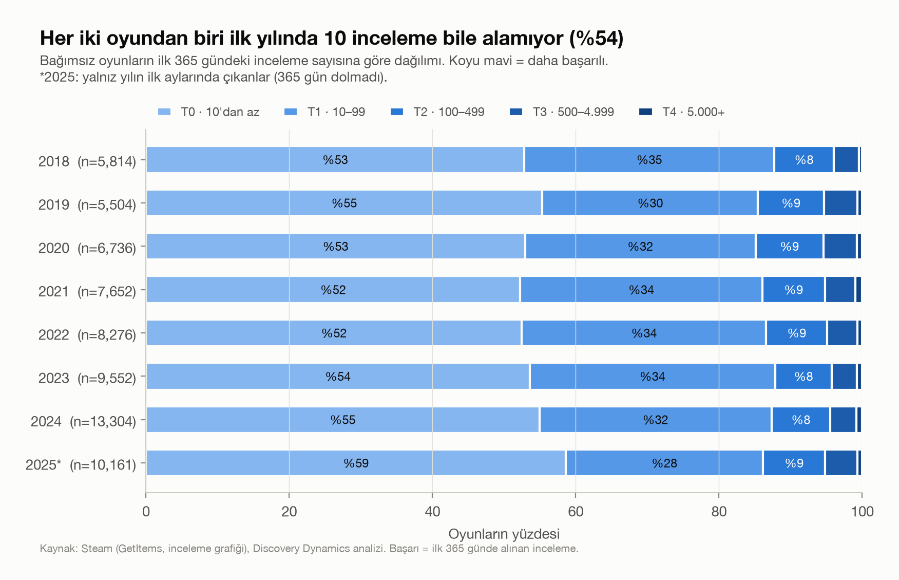

- Bağımsız oyunların **%54'ü** ilk yılında 10'dan az inceleme aldı. Bu, kabaca birkaç yüz satış demek.
- Yalnız **%5'i** hit oldu (500+ inceleme, kabaca on binlerce satış).
- Tablo 2018'den 2024'e şaşırtıcı derecede sabit. Her yıl kabaca aynı dağılım tekrarlanıyor.

### 2. Steam'e çıkan oyun 2,9 katına çıktı, ama öne çıkma şansı azalmadı

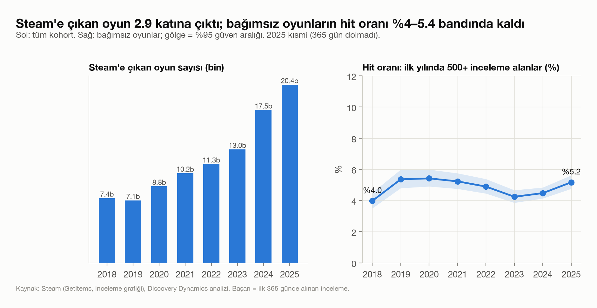

- Yıllık çıkan oyun 7,1 binden 20,4 bine çıktı.
- Bağımsız oyunların hit oranı ise **%4–5,5 bandında kaldı.** Mutlak hit sayısı 2018'de 231'den 2024'te 595'e çıktı.
- **Anlamı:** "Steam artık çok kalabalık, şans kalmadı" algısı veride görünmüyor. Kalabalık büyüdükçe görünür olan oyun sayısı da büyüyor. Rekabet artıyor, ama pay sabit.

### 3. Tür ve fiyat birlikte başarı şansını 10 kattan fazla değiştiriyor

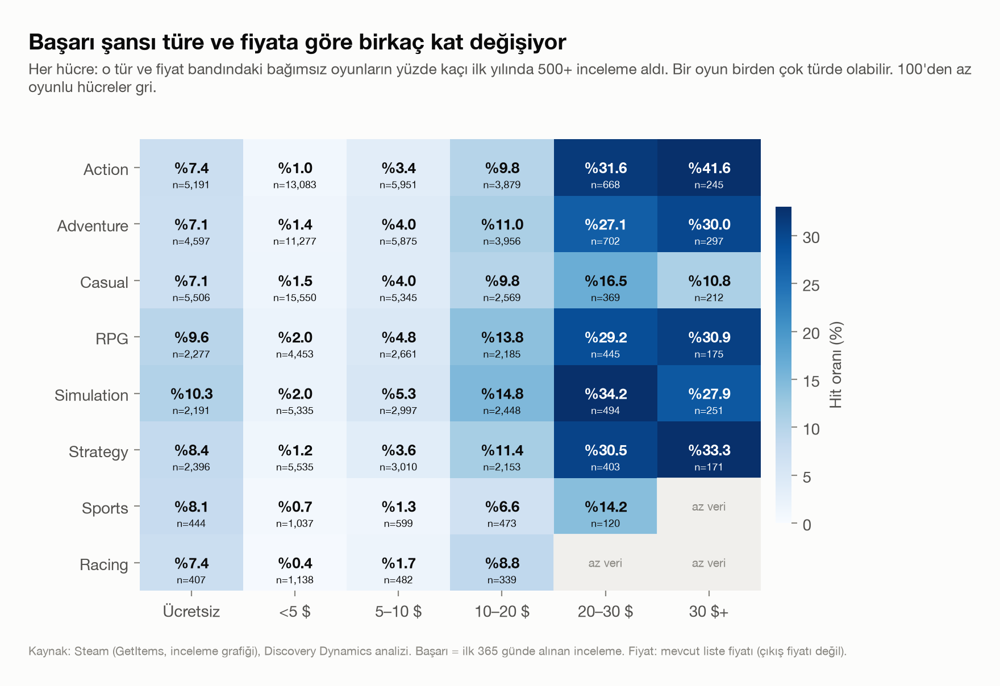

- 5 USD altı oyunlarda hit oranı her türde %0,4–2. 20 USD üstünde Action, RPG, Strategy ve Simulation'da **%28–42**.
- Casual oyunlar fiyat artınca diğerleri kadar yükselmiyor (20–30 USD'de %16,5).
- Ücretsiz (F2P) oyunlar %7–10 bandında. Ama bedava oyunun oyuncu başına inceleme oranı farklı olduğundan ücretli oyunlarla doğrudan karşılaştırılmamalı.

### 4. Diğer her şey sabitken: fiyat, yerelleştirme ve deneyim öne çıkıyor

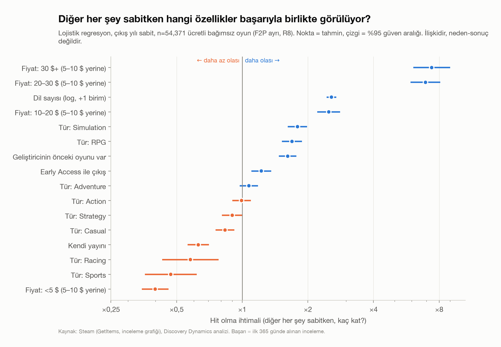

54.371 ücretli bağımsız oyunla yıl sabit lojistik regresyon. Değerler "hit olma ihtimali kaç kat":
- **Fiyat:** 20 USD üstü ×7, 10–20 USD ×2,5, 5 USD altı ×0,4 (hepsi 5–10 USD'ye göre).
- **Dil sayısı:** Daha çok dil desteği ×2,6 (log ölçek).
- **Geliştiricinin önceki oyunu var:** ×1,6. Ayrıntısı M6'da.
- **Tür:** Simulation ×1,8 ve RPG ×1,7 avantajlı; Sports ×0,5, Racing ×0,6 ve Casual ×0,8 dezavantajlı.
- **Kendi yayını:** ×0,63. Küçük bir yayıncıyla çıkan oyunlar daha sık başarılı.
- **Early Access ile çıkış:** ×1,2.

**Bunu nasıl okumamalı:** "Fiyatını artır, şansın 7 katına çıksın" **değil.** Fiyat büyük ihtimalle oyunun kapsamını, üretim kalitesini ve geliştiricinin özgüvenini yansıtıyor. 30 USD'lik bağımsız oyun genelde daha büyük bir projedir. Aynı şekilde çok dil desteği bütçeyi, küçük yayıncı da yayıncının iyi projeleri seçmesini yansıtabilir. Fiyatın veriyle izin verilen ölçüde ayrıntılı incelemesi K1'de yapılacak.

**Fiyat hakkında not:** Kullanılan fiyat çıkış fiyatı değil, Ekim 2026'daki liste fiyatı. Başarısız oyunlar sonradan fiyat düşürmüş olabilir; bu da ilişkiyi kısmen şişirebilir.

### 5. Steam'deki "gürültü" büyüyor

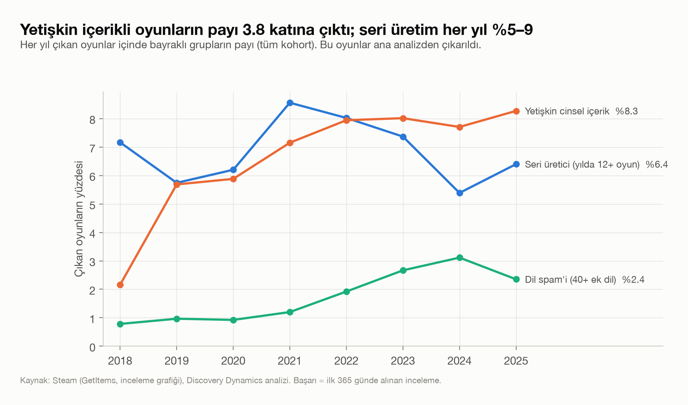

- Yetişkin cinsel içerikli oyunların çıkan oyunlar içindeki payı 2018'de %2,2'den 2025'te **%8,3'e** çıktı (3,8 kat).
- Yılda 12'den fazla oyun çıkaran seri üreticiler her yıl %5–9.
- 40'tan fazla dili desteklediğini iddia eden "dil spam'i" oyunları %0,8'den %2,4'e çıktı.
- Bunlar analizden çıkarıldı. Çıkarılmasalardı "görünmez oyun" oranı olduğundan yüksek, başarı oranı olduğundan düşük görünürdü.

### 6. Başarının dört yüzü: "hit" tek başına yetmiyor

*Betik: `analysis/m1b_basari_yuzleri.py`. Ölçüler sonuçlara bakılmadan tanımlandı (HIPOTEZLER, 2026-10-24).*

Başarıyı tek bir sayıyla ölçmek yerine dört açıdan bakıyoruz: **görünürlük** (inceleme sayısı), **beğeni** (olumlu oran), **ticari** (tahmini gelir) ve **göreli** (aynı yıl ve türdeki rakiplere göre sıra).

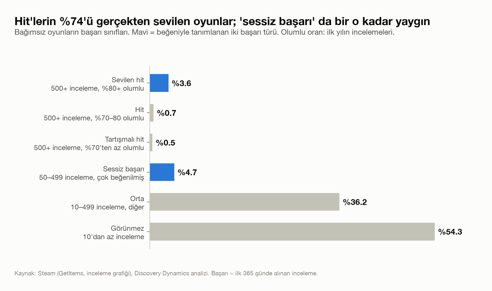

- Hit'lerin **%74'ü gerçekten sevilen oyunlar** (%80+ olumlu). "Çok satıp sevilmeyen" tartışmalı hit'ler nadir: oyunların %0,5'i.
- **Sessiz başarı** (50–499 inceleme ama çok beğenilmiş) oyunların %4,7'si; sevilen hit'ler (%3,6) kadar yaygın. Bu oyunlar küçük ama sadık bir kitle bulmuş. "Hit değil" diye başarısız sayılmamalı.

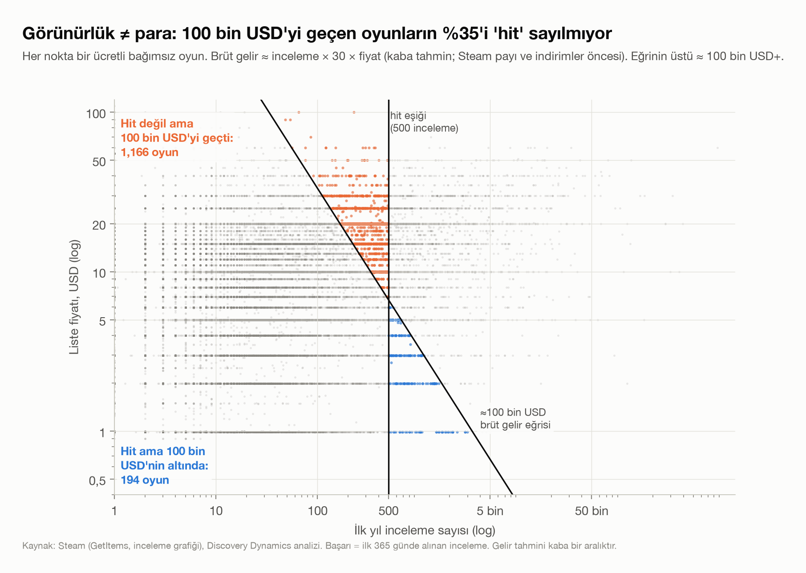

- Tahmini brüt geliri 100 bin USD'yi geçen 3.310 ücretli bağımsız oyunun **%35'i (1.166) "hit" sayılmıyor.** Bunlar 10–40 USD'ye satılan, 150–500 inceleme alan oyunlar: görünürlükleri orta, ama fiyatları sayesinde muhtemelen ayakta kalıyorlar.
- Tersi de var: 194 hit 100 bin USD'nin altında kalıyor; neredeyse hepsi 5 USD ve altındaki oyunlar.
- **Anlamı:** Geliştirici açısından "hit olmak" ile "geçimini çıkarmak" farklı hedefler. Düşük fiyatla çok görünür olmak, yüksek fiyatla orta görünürlükten daha az kazandırabiliyor.
- **Dikkat:** Gelir kaba bir tahmin (inceleme × 30 × fiyat; ×20–40 aralığı). Steam'in %30 payı, indirimler, bölgesel fiyatlar ve iadeler öncesi brüt değer. Net gelir kabaca bunun yarısı. Fiyat formülün içinde olduğu için bu ölçü fiyat analizinde sonuç olarak kullanılmayacak.

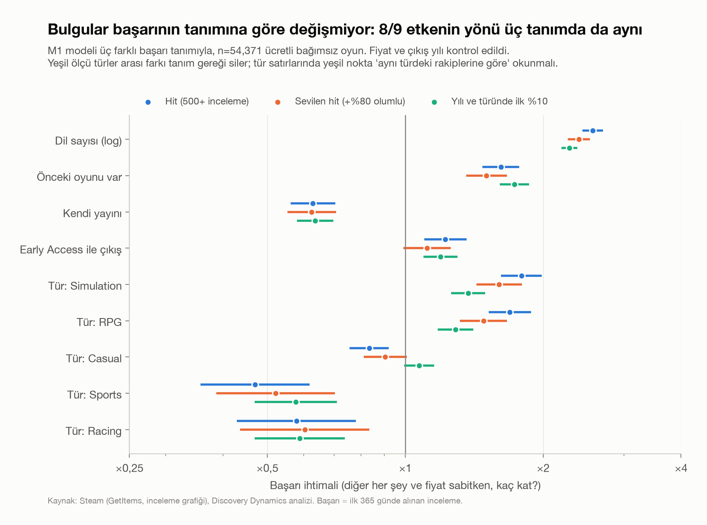

- M1 modeli üç farklı başarı tanımıyla yeniden kuruldu: hit, sevilen hit, yılı ve türünde ilk %10. **9 etkenin 8'inin yönü üç tanımda da aynı.** Dil sayısı, önceki oyun deneyimi, küçük yayıncıyla çıkmak, Early Access, Simulation ve RPG her tanımda olumlu; Sports ve Racing her tanımda olumsuz.
- Tek fark Casual'da: "yılı ve türünde ilk %10" ölçüsünde nötr çıkıyor. Bu beklenen bir sonuç, çünkü bu ölçü oyunu kendi türündeki rakipleriyle karşılaştırıyor ve türler arası farkı tanım gereği siliyor. Yani Casual oyunlar genel olarak daha az hit oluyor, ama Casual içinde başarılı olmanın koşulları diğer türlerden farklı değil.
- **Sonuç:** M1'in bulguları "başarıyı nasıl tanımladığımıza" bağlı değil. Bu, bulgulara güveni artırıyor.

### M1 özeti

| Bulgu | Güven | Not |
|---|---|---|
| Bağımsız oyunların %54'ü ilk yılında < 10 inceleme | Yüksek | Yıllar arasında tutarlı |
| Arz 2,9 kat arttı, hit oranı %4–5,5'te sabit | Yüksek | Mutlak hit sayısı 2,6 kat arttı |
| Yüksek fiyat, çok dil ve deneyim başarıyla birlikte görülüyor | Yüksek (ilişki) | Neden-sonuç değil; büyük ihtimalle bütçe ve kapsamı yansıtıyor |
| Simulation ve RPG avantajlı, Sports, Racing ve Casual dezavantajlı | Orta | Tür etiketleri geliştiricinin seçimi; birden çok tür olabilir |
| Yetişkin içerik payı 3,8 katına çıktı | Yüksek | Tüm kohort |
| Hit'lerin %74'ü sevilen hit; sessiz başarı (%4,7) sevilen hit (%3,6) kadar yaygın | Yüksek | Steam'in puan ölçeğine göre |
| 100 bin USD'yi geçenlerin %35'i hit değil | Orta | Gelir kaba tahmin (×20–40 aralığı) |
| Etkenlerin 8/9'u üç farklı başarı tanımında aynı yönde | Yüksek | Casual farkı ölçünün yapısından |

---

## M2: İçerik DNA'sı: neyin içinde olduğu fark yaratıyor mu?

*Betikler: `analysis/m2_icerik.py`, `analysis/m2b_cince_ters_nedensellik.py` · 2026-10-24. Doğrulayıcı testler: H6, H7. Holm düzeltmesi H1–H7 ailesi tamamlanınca uygulanacak; p değerleri şimdilik ham.*

### H6: Basitleştirilmiş Çince desteği: **desteklendi (ilişki), ama bir kısmı ters nedensellik**

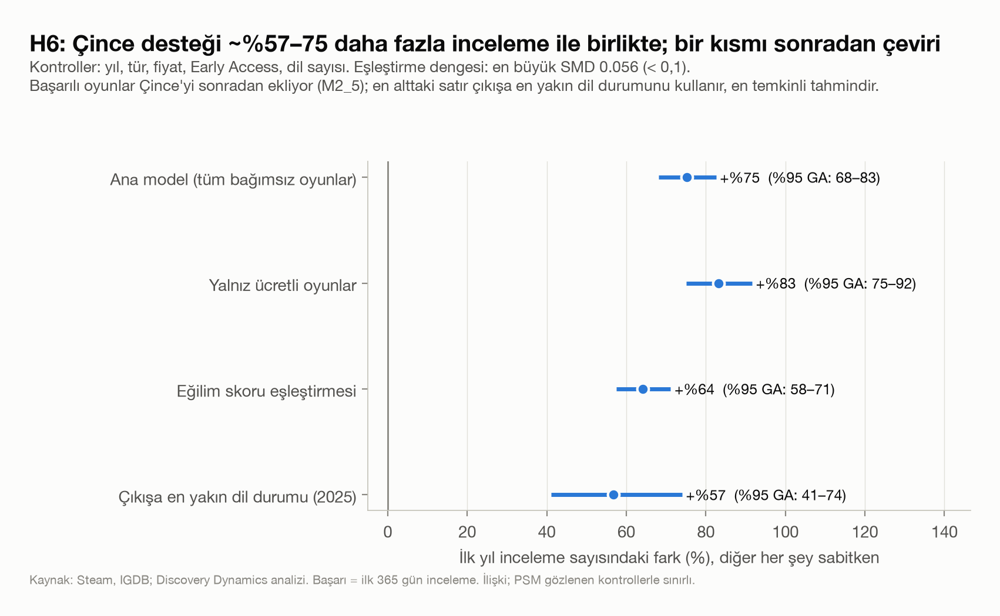

- Diğer her şey sabitken Çince arayüz desteği olan oyunlar ilk yılında **%75 daha fazla inceleme** alıyor (%95 GA: 68–83). Eğilim skoru eşleştirmesiyle +%64 (58–71); eşleştirme dengesi bütün kontrollerde iyi (en büyük fark 0,056 < 0,1).
- **Ama başarılı oyunlar Çince'yi sonradan ekliyor:**

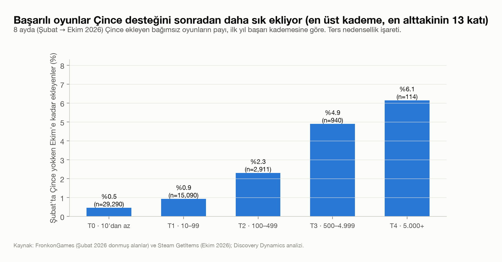

- Şubat'tan Ekim 2026'ya, sadece 8 ayda, en başarılı oyunların %6,1'i Çince ekledi; en alttakilerin %0,5'i (13 kat fark). Yani "Çince → başarı" ilişkisinin bir kısmı aslında "başarı → Çince".
- Çıkışa en yakın dil durumunu kullanan en temkinli tahmin **+%57** (41–74). Bu da çıkıştan 5–13 ay sonrasını yansıttığı için bir **üst sınır** olarak okunmalı.
- **Geliştirici için anlamı:** Çince desteği güçlü biçimde başarıyla birlikte görülüyor ve etki ters nedensellik ayıklandıktan sonra da büyük kalıyor. Yine de "Çince ekle, %57 daha çok inceleme al" demek için neden-sonuç tasarımı gerekir. Bu veriyle mümkün değil, çünkü çıkış günündeki dil listesi gözlenmiyor.
- Ön kayıttaki yan kanıt (Çince yazılmış incelemelerin payı) inceleme dili verisi gerektiriyor; **test edilemedi.**

**Bu analizde düzeltilen iki hata:**
1. İlk eşleştirme yalnız eğilim skoruyla yapılmıştı ve Action/RPG türlerinde denge ölçütünü tutturamadı (fark 0,17). Tür kombinasyonu ve fiyat bandında birebir eşleştirme eklenince düzeldi.
2. Ters nedensellik testinin ilk sürümünde "Şubat" ve "Ekim" için iki farklı açık veri seti kullanılmıştı ve test sıfır değişiklik buldu. Kontrol edince iki setin 122.876 oyunda birebir aynı olduğu anlaşıldı: FronkonGames'in oyun bilgileri Şubat 2026'da donmuş. Test, Ekim durumu için kendi Steam çekimimizle yeniden kuruldu.

### H7: Doygunluk: **desteklenmedi**

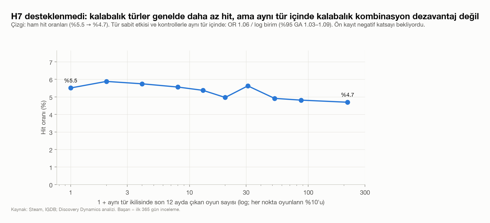

- Ham tabloda kalabalık kombinasyonlarda hit oranı biraz düşük (%5,5'ten %4,7'ye).
- Ama ön kayıtlı test (tür sabit etkisi ve kontrollerle) ilişkinin **tersine** döndüğünü gösteriyor: aynı ana tür içinde daha kalabalık kombinasyonlarda başarı ihtimali biraz **daha yüksek** (log birim başına OR 1,06; %95 GA 1,03–1,09). Diğer doygunluk ölçüsüyle de aynı (OR 1,05).
- **Yorum:** Düşüş türler arası farktan geliyor: kalabalık türler (Casual, Action) zaten daha az hit veriyor. Aynı tür içinde ise kalabalık bir alt tür, büyük ihtimalle oyuncu talebinin işareti. "Kalabalık alandan kaç" tavsiyesi veriyle desteklenmiyor; "talebin olduğu yerde ol" daha yakın.

### Keşifsel: Hangi içerik etiketleri başarıyla birlikte görülüyor?

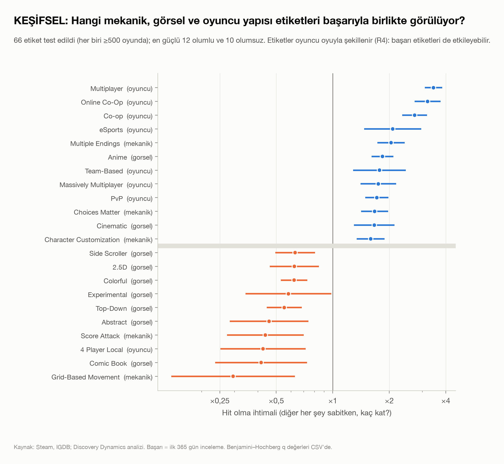

- 66 mekanik, görsel ve oyuncu yapısı etiketi test edildi; 36'sı çoklu test düzeltmesinden (BH, q < 0,05) sonra da anlamlı.
- **En güçlü olumlu ilişkiler oyuncu yapısında:** Multiplayer ×3,4, Online Co-Op ×3,2, Co-op ×2,7, eSports ×2,1. Hikâye mekanikleri de olumlu: Multiple Endings ×2,05, Choices Matter ×1,6. Görselde Anime ×1,8 ve Cinematic ×1,6.
- **Olumsuz:** Grid-Based Movement ×0,29, Comic Book ×0,42, 4 Player Local ×0,43, Score Attack ×0,44, Abstract ×0,46. Ayrıca yaygın görsel tercihler (Top-Down, Colorful, Side Scroller, 2.5D) ×0,55–0,6.
- **Dikkat:** Çok oyunculu oyunlar oyuncu başına daha çok inceleme alıyor olabilir (arkadaşlarla oynanır, topluluk büyür). Ayrıca etiketler oyuncu oyuyla şekillendiği için başarı etiketleri de etkileyebilir (R4). Bunlar keşifsel ilişkiler.

### Keşifsel: Oyuncu motivasyonu haritası

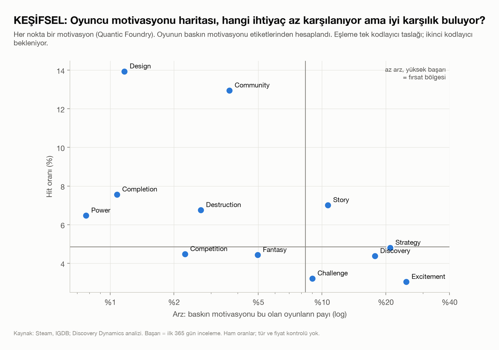

- **"Fırsat bölgesi"** (az arz, yüksek başarı): **Design** (yaratma, inşa, kişiselleştirme; oyunların %1,2'si, hit oranı %14) ve **Community** (birlikte oynama; %3,7 arz, %13 hit).
- **En kalabalık ve en zor:** **Excitement** (aksiyon heyecanı; oyunların %25'inin baskın motivasyonu, hit oranı %3) ve **Challenge** (zorluk; %9 arz, %3,2 hit).
- **Dikkat:** Ham oranlar (tür ve fiyat kontrolü yok). Etiket–motivasyon eşlemesi tek kodlayıcı taslağı; ikinci kodlayıcı (Mert) beklendiği için bu harita **ön bulgu**.

### M2 özeti

| Bulgu | Sonuç | Not |
|---|---|---|
| H6 · Çince desteği | **Desteklendi (ilişki)**: +%57 ile +%75 arası | Ters nedensellik kanıtlandı; +%57 en temkinli, yine de üst sınır |
| H7 · Doygunluk | **Desteklenmedi**: aynı tür içinde katsayı pozitif (OR 1,06) | Ham düşüş türler arası farktan |
| Çok oyunculu / co-op | ×2,7–3,4 (keşifsel) | Oyuncu başına inceleme farkı olabilir |
| Fırsat motivasyonları: Design, Community | Az arz, ~%13–14 hit (keşifsel, ham) | Eşleme taslak |

---

## M3: Yenilik: "tanıdık ama farklı" mı kazanıyor?

*Betik: `analysis/m3_yenilik.py` · 2026-10-24. Doğrulayıcı test: H1. Yenilik ölçüsü = oyunun etiket kombinasyonunun, kendisinden önce çıkmış en benzer 10 oyuna uzaklığı (mekanik buluşu değil, etiket kombinasyonunu ölçer).*

### H1: Ters U: **desteklenmedi**

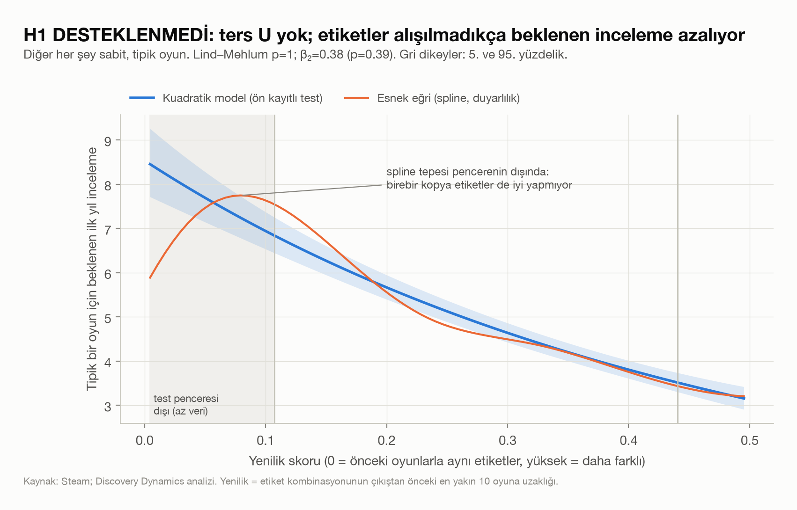

- Ön kayıt, orta düzeyde yenilikçi oyunların en iyi sonucu alacağını (ters U) öngörüyordu. Veri bunu desteklemiyor: test penceresinde (oyunların %90'ı) ilişki **tek yönlü ve azalan.**
  - Eğim pencerenin iki ucunda da negatif ve anlamlı (t = −11,1 ve −9,2).
  - Kuadratik terim anlamsız (p = 0,39).
  - Lind–Mehlum p = 1.
- **Büyüklük:** Diğer her şey sabitken tipik bir oyunun beklenen ilk yıl incelemesi, yenilik skoru 0,11'den 0,44'e çıkınca kabaca **yarıya** iniyor.
- **Duyarlılık:** Komşu sayısı 5 ya da 20 alındığında, sonuç hit olarak ölçüldüğünde ve az oylanmış oyunlarda (R4) sonuç değişmiyor: ters U hiçbirinde yok. Az oylanmış oyunlarda yüksek yenilikteki düşüş de sürüyor (t = −2,6); bulgu etiket oylamasının bir yan ürünü değil.
- **Keşifsel ayrıntı:** Esnek eğri, test penceresinin altında (oyunların en tanıdık %5'i) bir tepe ve sonra düşüş gösteriyor. Etiketleri önceki oyunlarla neredeyse birebir aynı olan oyunlar da iyi yapmıyor olabilir. Bu bölgede veri az; ön kayıtlı test kapsamında değil.

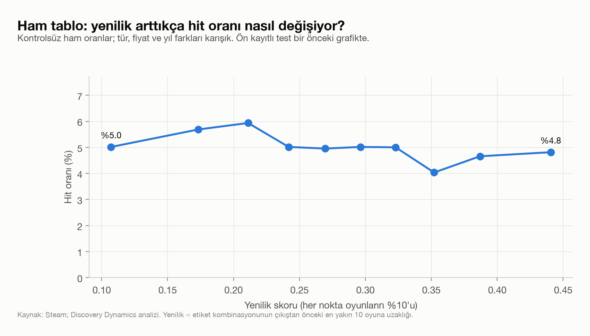

- Ham tabloda hafif bir tepe var (yenilik 0,21'de %5,9 hit), ama tür, fiyat ve yıl kontrol edilince kayboluyor. Ham tepe büyük ihtimalle tür karışımından geliyor.

**Geliştirici için anlamı:** "Biraz farklı ol" tavsiyesi veride görünmüyor. Etiket kombinasyonu olarak **tanıdık** oyunlar daha iyi yapıyor: oyuncular aradıkları türü bulabildiklerinde satın alıyor. Ama bu bulgu iki sınırla birlikte okunmalı:
1. Ölçü mekanik buluşu yakalamıyor. Vampire Survivors gibi türü değiştiren oyunlar etiket olarak "tanıdık" görünüyor (bkz. veri raporu).
2. Alışılmadık etiket kombinasyonu bazen sadece niş ya da deneysel bir projeye işaret ediyor olabilir.

En doğru özet: "Tanıdık bir kalıbın içinde fark yaratmak", "alışılmadık bir kalıp kurmaktan" daha güvenli görünüyor.

---

## M4: Yörüngeler: oyunların ilgisi zaman içinde nasıl değişiyor?

*Betik: `analysis/m4_yorunge.py` · 2026-10-24. Doğrulayıcı test: H4. Ölçüm ayrıntısı test öncesi kayda geçti (HIPOTEZLER).*

### H4: Early Access ve uzun kuyruk: **desteklendi**

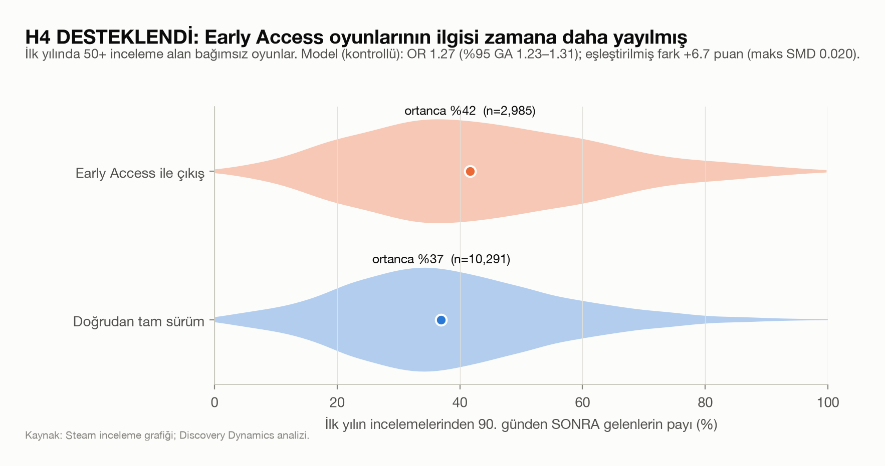

- İlk yılında 50+ inceleme alan 13.276 bağımsız oyunda, Early Access ile çıkanların incelemeleri zamana daha yayılmış. İlk yılın incelemelerinin 90. günden sonra gelen payının ortancası: **%42** (Early Access), **%37** (doğrudan tam sürüm).
- **Kontrollü model:** OR 1,27 (%95 GA 1,23–1,31). **Eşleştirilmiş karşılaştırma:** +6,7 puan (5,8–7,6). Eşleştirme dengesi çok iyi (en büyük fark 0,02).
- **Mekanizma:** Early Access oyunları genellikle ilk yıl içinde tam sürüme (1.0) geçiyor ve bu ikinci bir ilgi dalgası yaratıyor. Hipotezin öngördüğü "zamana yayılmış başarı" büyük ölçüde bu ikinci lansmanın etkisi olabilir.
- **Not:** Steam'in EA kaydı tutmadığı ve tarihini bizim düzelttiğimiz 808 oyunun bir kısmı aslında EA'ydı ama "EA değil" sayılıyor. Bu, farkı küçültme yönünde çalışır.

### Keşifsel: İnceleme eğrisi tipleri

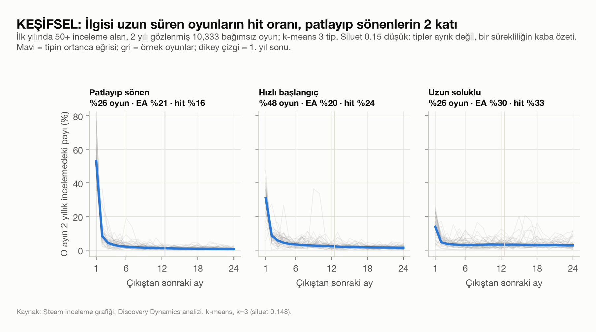

- 2 yılı gözlenmiş 10.333 oyunun aylık inceleme eğrisi kümelendi. Net ayrık tipler yok (siluet 0,15), eğriler bir süreklilik oluşturuyor. Üç tip bunun kaba bir özeti:
  - **Patlayıp sönen (%26):** İncelemelerin yarısından fazlası ilk ayda; ikinci yılda neredeyse hiç (%9). Hit oranı **%16**.
  - **Hızlı başlangıç (%48):** İlk ay güçlü, sonra yavaşça azalan. Hit oranı %24.
  - **Uzun soluklu (%26):** İlk ay görece küçük, sonra iki yıl boyunca düz ve kalıcı; ikinci yıl iki yıllık incelemelerin %36'sı. Hit oranı **%33**, sevilen hit oranı %27; dört grubun en yükseği. Early Access payı da en yüksek (%30).
- **Anlamı:** En başarılı oyunlar büyük bir lansman patlamasıyla değil, **kalıcı ilgiyle** başarıya ulaşıyor. Lansman haftasına her şeyi yatırmak yerine güncellemeler, içerik ve topluluk ile ilgiyi sürdürmek daha iyi sonuçla birlikte görülüyor.
- **Sınır:** Örneklem ilk yılında 50+ inceleme alanlarla sınırlı. Kümeleme yöntemi ön kayıttan saptı: DTW yerine aylık profillerde k-means (gerekçesi HIPOTEZLER'de).

---

## M6: İkinci oyun: stüdyolar ikinci denemede daha mı başarılı?

*Betik: `analysis/m6_ikinci_oyun.py` · 2026-10-24. Doğrulayıcı test: H5.*

### H5: İkinci oyun etkisi: **desteklenmedi**

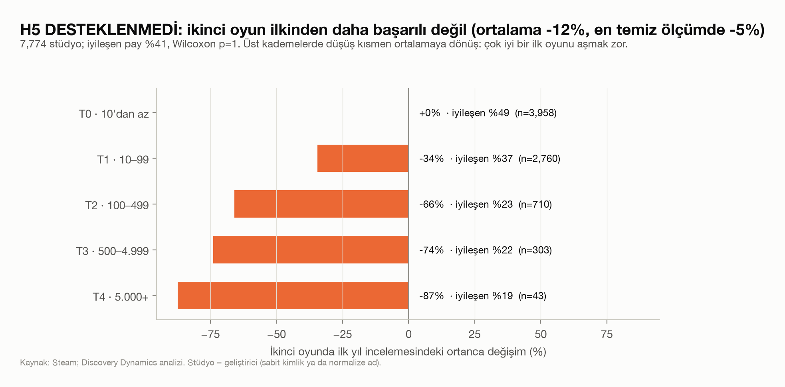

- İlk iki oyunu da analiz örnekleminde olan 7.774 stüdyoda ikinci oyun ilkinden **daha başarılı değil.** Stüdyoların %41'i ikinci oyununda daha çok inceleme aldı. Birinci farklar modeli (stüdyo sabit etkisine denk; arada geçen süre, tür, fiyat, dil ve EA farkları kontrol edildi) ortalama **−%12** gösteriyor (%95 GA: −15 ile −8).
- **Sağlamlık:**

| Örneklem | Değişim | İyileşen |
|---|---|---|
| Ana | −%12 [−15, −8] | %41 |
| İkinci oyun büyük yayıncıyla da olabilir | −%12 [−16, −8] | %42 |
| Yalnız Steam sabit kimlikli stüdyolar (ad eşleşme hatası yok) | −%9 [−15, −1] | %44 |
| **Yalnız iki oyunu da tam seriyle ölçülenler** | **−%5 [−12, +2]** | %48 |

- Negatif farkın bir kısmı ölçümden geliyor. 10'dan az incelemeli oyunlarda ilk yıl değeri ömür boyu sayının üst sınırı; eski ilk oyun daha uzun süre biriktirmiş oluyor. En temiz ölçümde fark sıfırdan ayırt edilemiyor. **Doğru özet: ikinci oyunun daha iyi olduğuna dair kanıt yok.**
- **Kademeye göre:** İlk oyunu ne kadar başarılıysa ikinci oyun o kadar geride kalıyor (T2'de −%66, T4'te −%87). Bu büyük ölçüde **ortalamaya dönüş**: çok iyi giden bir ilk oyun kısmen şansla da iyi gitmiştir ve bunu tekrarlamak zordur.

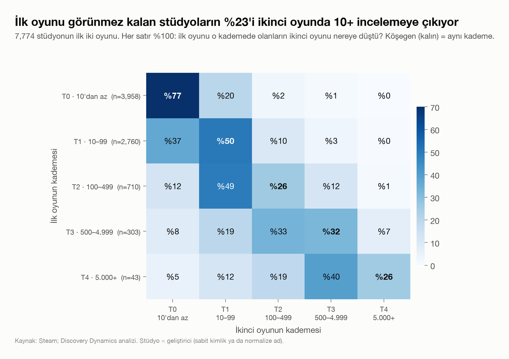

- İlk oyunu görünmez kalan (T0) stüdyoların **%77'si ikinci oyunda da görünmez** kalıyor. Sadece %3'ü 100+ incelemeye çıkıyor.
- İlk oyunu hit olan (T3) stüdyoların üçte biri yine hit yapıyor (%32 + %7). Bu, rastgele bir oyunun hit olma ihtimalinin (%5) yaklaşık 8 katı. **Başarı tekrarlanmıyor, ama tamamen şans da değil:** başarılı stüdyolar başarılı kalma eğiliminde.

**M1 ile çelişiyor mu?** M1'de "geliştiricinin önceki oyunu var" ×1,6 olumlu çıkmıştı. Çelişki yok, çünkü iki bulgu farklı şeyler ölçüyor:
- **M1 stüdyolar arası karşılaştırma:** ikinci oyun çıkaran stüdyolar, ilk oyunu iyi gittiği için devam eden seçilmiş bir grup.
- **M6 aynı stüdyonun içi:** aynı stüdyonun ikinci oyunu ortalamada ilkini geçmiyor.

**Geliştirici için anlamı:** "İlk oyun deneme, ikincide tutar" beklentisi veriyle desteklenmiyor. İlk oyunu görünmez kalan stüdyoların büyük çoğunluğu ikincide de görünmez kalıyor. Bir şeyin değişmesi gerekiyor: tür, kapsam, pazarlama, ya da M2–M4'teki etkenler.

---

## Keşifsel analizler (K1–K4)

*Ön kayıtta yoktu; sonuçlara bakılmadan 2026-10-24'te kayda geçirildi (HIPOTEZLER). Holm ailesinin dışında, "keşifsel" etiketiyle raporlanır.*

### K2: Yapay zekâ içerik beyanı

*Betik: `analysis/k2_yapay_zeka.py`*

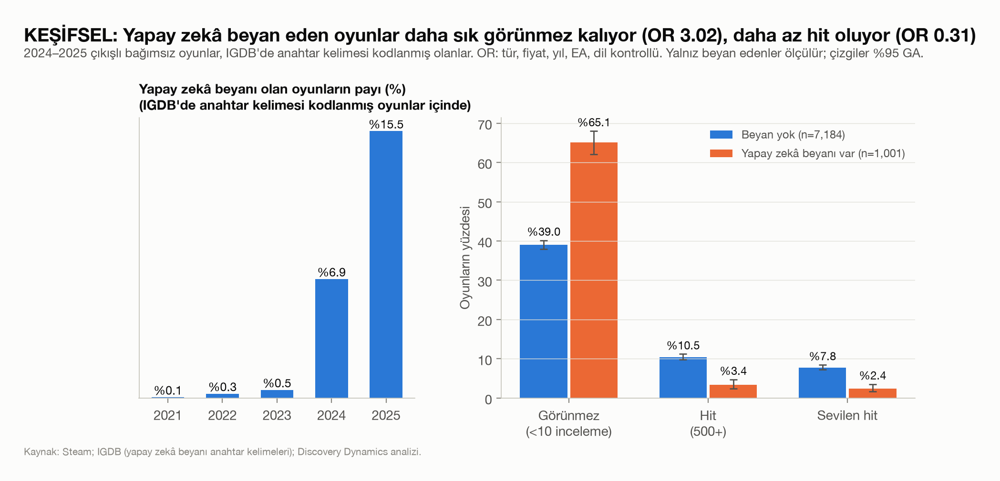

- Steam Ocak 2024'ten beri oyunlarda yapay zekâ kullanımının beyan edilmesini istiyor. IGDB bu beyanları anahtar kelime olarak aktarıyor (görsel, müzik, ses, çeviri, pazarlama, kod; Steam'in kategorileriyle birebir). IGDB'de anahtar kelimesi kodlanmış oyunlar içinde beyan oranı 2023'te %0,5, 2024'te **%6,9**, 2025'te **%15,5.**
- 2024–2025 çıkışlı 8.185 bağımsız oyunda, yapay zekâ beyan eden 1.001 oyun:
  - **%65'i görünmez kaldı** (beyan etmeyenlerde %39). Kontrollü OR **×3,0** (2,6–3,5).
  - %3,4'ü hit oldu (beyan etmeyenlerde %10,5). OR ×0,31.
  - %2,4'ü sevilen hit oldu (%7,8'e karşı).
  - 50+ incelemeli olanların ortanca olumlu oranı **5,6 puan daha düşük.**
- **Nasıl okunmalı:** Bu bir neden-sonuç değil. Yapay zekâ beyanı büyük ihtimalle düşük bütçeli, hızlı üretilmiş projelerle birlikte görülüyor. Ama oyuncuların beyanı görüp tepki vermesi (daha düşük beğeni) de mümkün. İki açıklama bu veriyle ayrılamaz.
- **Sınırlar:**
  - Steam API'leri beyanı döndürmüyor (doğrudan kontrol edildi). Mağaza sayfalarını HTML olarak taramak kaynak politikasına aykırı olduğu için kullanılmadı.
  - Yalnız **beyan eden** oyunlar ölçülüyor; kullanıp beyan etmeyenler "beyan yok" grubunda. Bu, farkı küçültme yönünde çalışır.
  - IGDB'nin anahtar kelime kodladığı oyunlar genelden daha başarılı (bu alt örneklemde görünmezlik %39, tüm kohortta %54). Mutlak oranlar değil, fark yorumlanmalı.

### K1: Fiyatın tatlı noktası

*Betik: `analysis/k1_fiyat.py`. Ücretli bağımsız oyunlar (54.371). Ticari başarı sonuç olarak kullanılmadı, çünkü fiyat gelir formülünün içinde.*

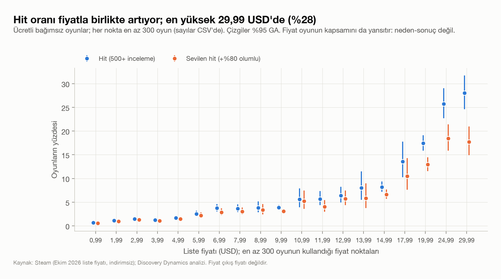

- **Hit oranı fiyatla neredeyse düzenli artıyor:**

| Fiyat (USD) | 0,99 | 4,99 | 9,99 | 14,99 | 19,99 | 24,99 | 29,99 |
|---|---|---|---|---|---|---|---|
| Hit oranı | %0,7 | %1,7 | %3,9 | %8,2 | %17 | %26 | %28 |

- Belirgin sıçramalar 9,99 → 10,99 (%3,9 → %5,6) ve 14,99 → 17,99 (%8 → %14) geçişlerinde.

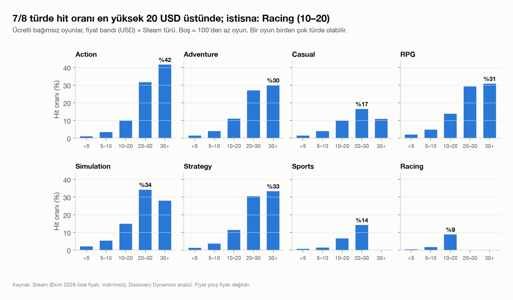

- 8 türün 7'sinde hit oranı 20 USD üstünde en yüksek. **Racing** istisna: en iyi bant 10–20 USD (%9), daha pahalı Racing oyunu zaten çok az.
- Casual, Simulation ve Sports 20–30 USD'de tepe yapıp 30 USD üstünde düşüyor. Action, RPG ve Strategy'de 30 USD üstü de iyi.

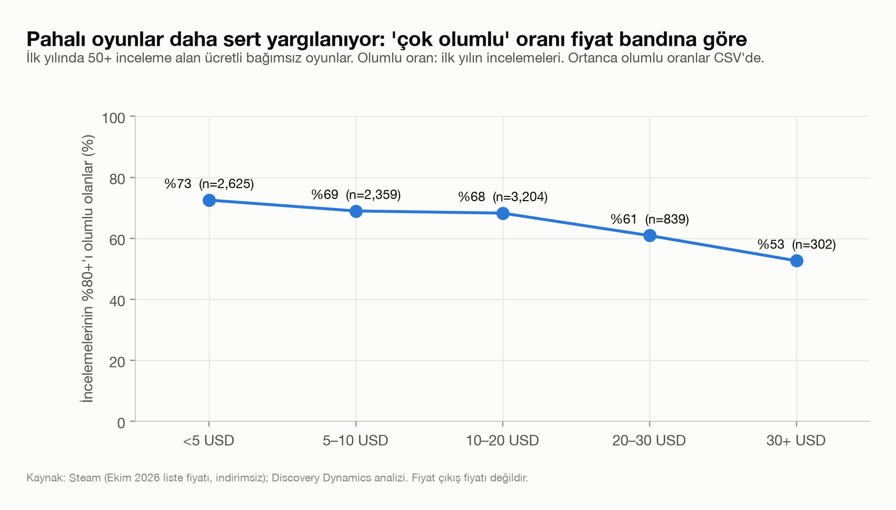

- **Pahalı oyunlar daha sert yargılanıyor.** İlk yılında 50+ inceleme alan oyunlarda "çok olumlu" (%80+) oranı 5 USD altında %73, 30 USD üstünde %53. Oyuncular yüksek fiyat karşılığında daha çok bekliyor.
- **Dikkat:** 50+ inceleme şartı ucuz oyunlarda daha seçici bir alt grup bırakıyor (5 USD altında 50+ inceleme almak zaten istisnai başarı). Bu farkın bir kısmını açıklayabilir.

**Geliştirici için anlamı ve sınırları:**
- **Bu bir "fiyatını artır" tavsiyesi değil.** Fiyat büyük ölçüde oyunun kapsamını, üretim değerini ve geliştiricinin güvenini yansıtıyor; 25 USD'lik bağımsız oyun genelde daha büyük bir projedir.
- Kullanılan fiyat çıkış fiyatı değil, Ekim 2026 liste fiyatı. Başarısız oyunların sonradan fiyat düşürmesi ucuz oyunların dezavantajını kısmen şişirebilir.
- Güvenle söylenebilecek olan: **5 USD altı bir "görünürlük tuzağı" gibi duruyor** (her türde hit oranı %0,4–2). Ayrıca daha yüksek fiyat, beğeni çıtasını da yükseltiyor.
