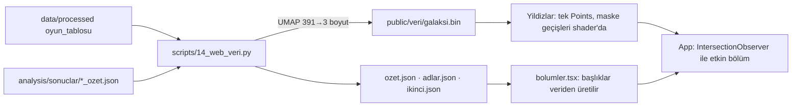

# Steam Galaksisi (web taslağı)

2018–2025 arasında Steam'de çıkan 92.492 oyunun etiket benzerliğine göre 3B haritası ve Discovery Dynamics bulgularının kaydırmalı anlatısı.



- **Neden ikili dosya:** 92 bin yıldızın konum, parlaklık ve bayrakları 1,9 MB'lık tek `ArrayBuffer`; JSON'da ~4 katı olur ve ayrıştırması ana iş parçacığını kilitler.
- **Neden backend yok:** Tüm veri durağan; bölüm maskeleri istemcide bayt dizilerinden hesaplanıyor.
- **Metin kuralı:** Sayılar ve yönler `ozet.json`'dan gelir (elle sayı yazılmaz); Türkçe ekler sayıya göre `src/lib/ek.ts`'te seçilir.

```bash
cd web && npm install && npm run dev
```

Veriyi yeniden üretmek (proje kökünden): `cd scripts && uv run --no-project --python 3.12 --with pandas --with pyarrow --with pyyaml --with requests --with numpy --with umap-learn python 14_web_veri.py`

Kontroller: `npm run typecheck`, `npm run build`, `npm run slop`.
